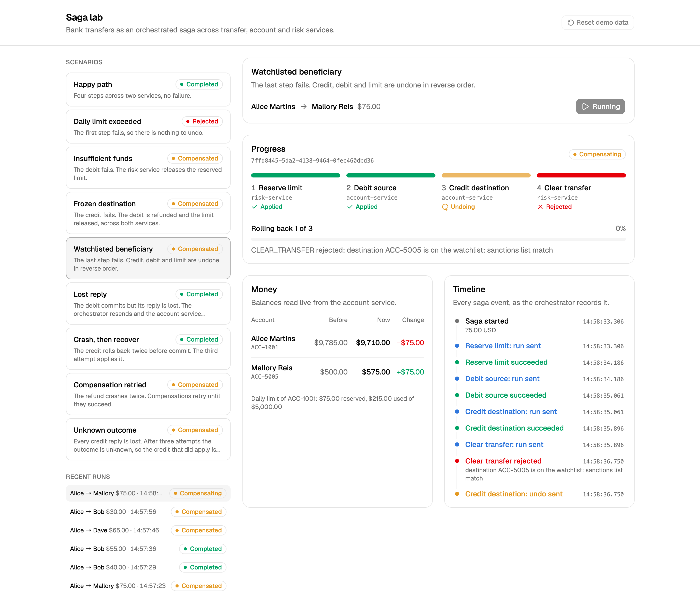
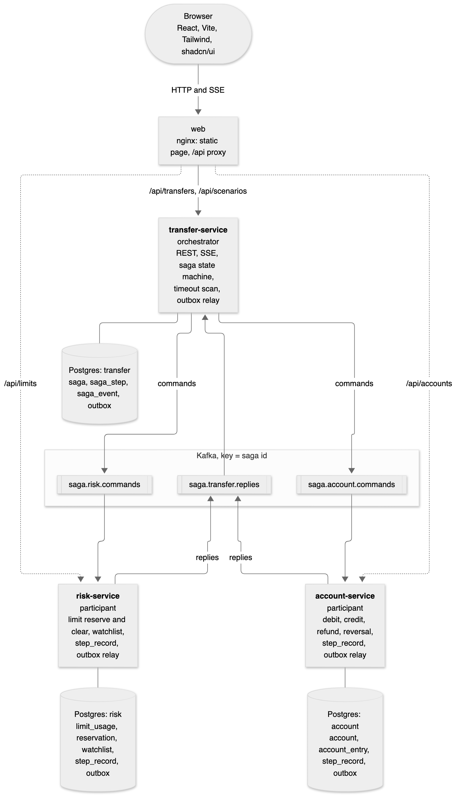
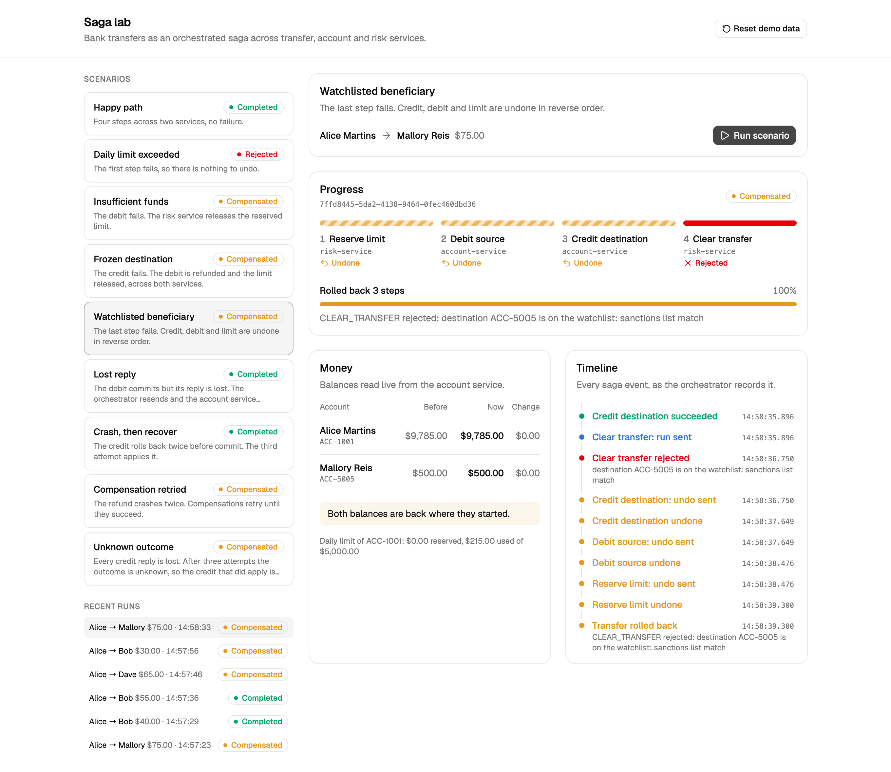
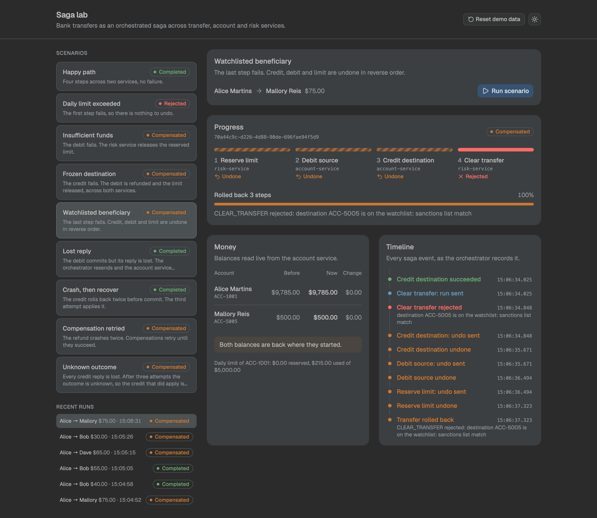
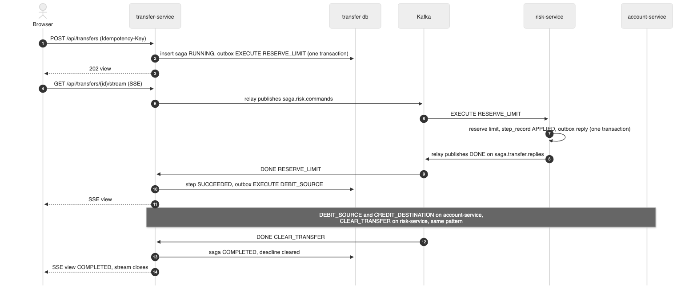
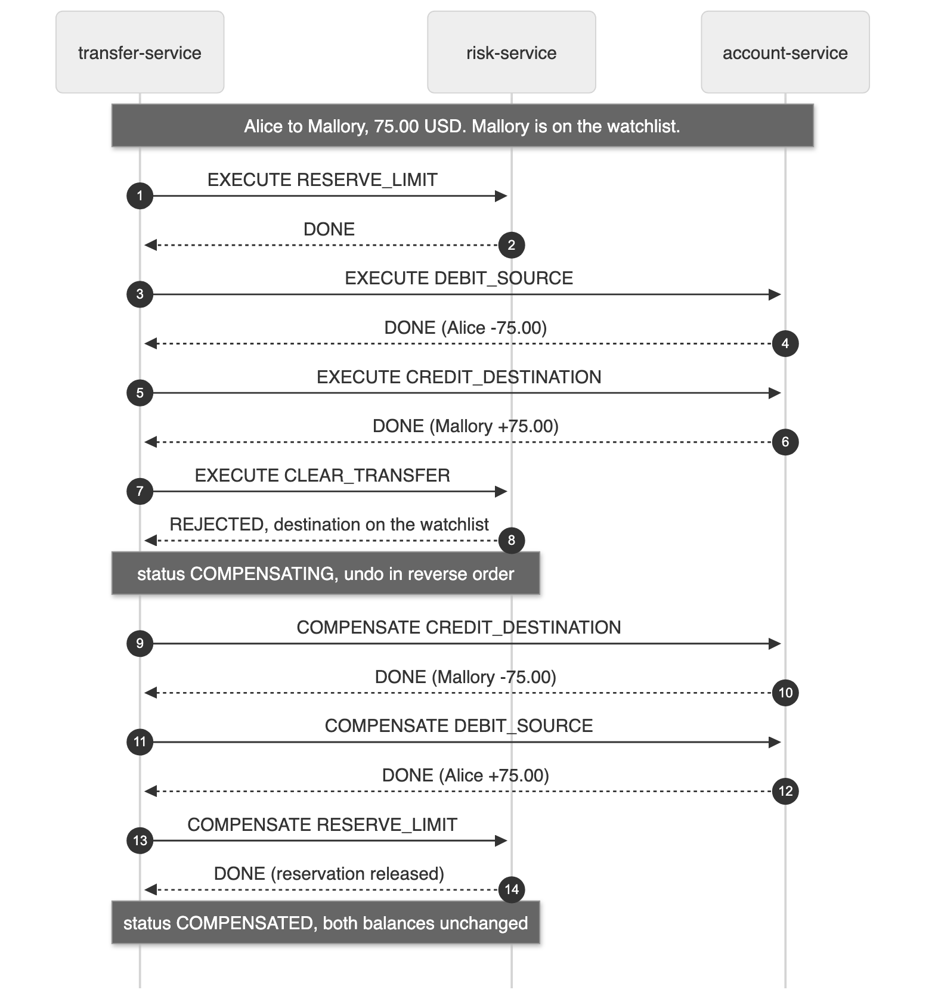
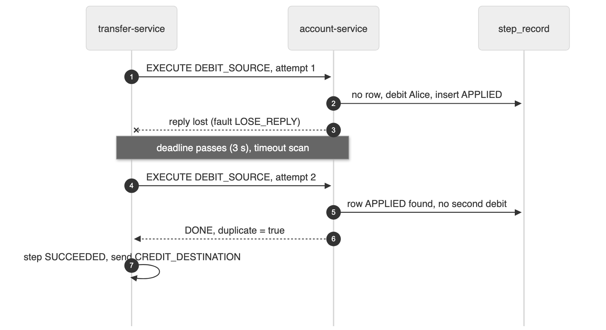
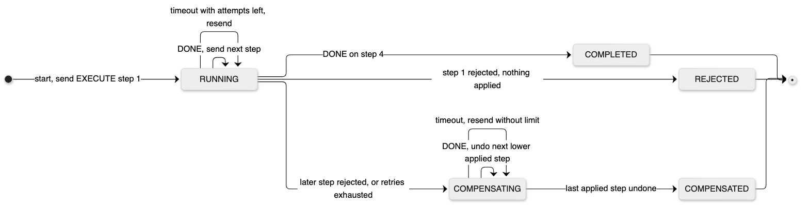
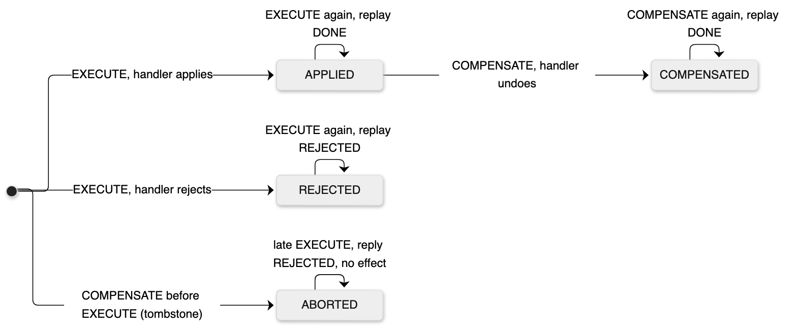

# java-saga-pattern

Bank transfers between accounts of different owners, run as an orchestrated saga across three Spring Boot services. Each step has a compensation. A web page runs ten scenarios on demand and shows every step, retry and rollback live.



## Architecture



| Service | Role | Owns |
|---|---|---|
| `transfer-service` | Orchestrator. REST API, saga state machine, timeout scan, SSE progress | `saga`, `saga_step`, `saga_event` |
| `account-service` | Participant. Debit, credit, refund, reversal | `account`, `account_entry` |
| `risk-service` | Participant. Daily limit reserve and clear, watchlist | `limit_usage`, `reservation`, `watchlist` |
| `messaging` | Shared jar. Message contracts, outbox and relay, participant runtime | `outbox`, `step_record` |
| `web` | React page served by nginx | - |

Steps run over Kafka as commands and replies. Each service writes its state change and its outgoing message in one Postgres transaction (transactional outbox). Participants are idempotent on `(saga_id, step)`.

| # | Step | Service | Rejects when | Compensation |
|---|---|---|---|---|
| 1 | `RESERVE_LIMIT` | risk | over the daily limit | release the reservation |
| 2 | `DEBIT_SOURCE` | account | insufficient funds, frozen, other currency | refund |
| 3 | `CREDIT_DESTINATION` | account | frozen, other currency | reverse the credit |
| 4 | `CLEAR_TRANSFER` | risk | destination on the watchlist | move the amount back to reserved |

The manual approval scenario adds a fifth step, `APPROVE_TRANSFER`, between debit and credit. The orchestrator owns it, so no command goes out: the saga waits until you press Approve or Decline on the page, or until the approval expires after 2 minutes. Decline and expiry roll back the debit and the limit.

The screening is the last step on purpose, so one scenario rolls back everything in both participants. In production it runs first.

## Run it

Needs Docker, and for `make test` a JDK 25 and Node 26.

```bash
make up      # postgres, kafka, three services, web
open http://localhost:8080
make e2e     # every scenario against the running stack
make down
```

`make e2e` resets the demo data, runs the catalog (the approval scenario twice, approved and declined), and checks the outcome, both balances of each transfer, the total of all balances, and that no limit reservation is left behind:

```
ok    happy-path                 COMPLETED    ACC-1001 10000.00 -> 9880.00, ACC-2002 2500.00 -> 2620.00
ok    limit-exceeded             REJECTED     ACC-1001 9880.00 -> 9880.00, ACC-2002 2620.00 -> 2620.00
ok    insufficient-funds         COMPENSATED  ACC-3003 80.00 -> 80.00, ACC-2002 2620.00 -> 2620.00
ok    frozen-destination         COMPENSATED  ACC-1001 9880.00 -> 9880.00, ACC-4004 1000.00 -> 1000.00
ok    watchlisted-beneficiary    COMPENSATED  ACC-1001 9880.00 -> 9880.00, ACC-5005 500.00 -> 500.00
ok    lost-reply                 COMPLETED    ACC-1001 9880.00 -> 9840.00, ACC-2002 2620.00 -> 2660.00
ok    crash-then-recover         COMPLETED    ACC-1001 9840.00 -> 9785.00, ACC-2002 2660.00 -> 2715.00
ok    compensation-retried       COMPENSATED  ACC-1001 9785.00 -> 9785.00, ACC-4004 1000.00 -> 1000.00
ok    unknown-outcome            COMPENSATED  ACC-1001 9785.00 -> 9785.00, ACC-2002 2715.00 -> 2715.00
ok    manual-approval (approve)  COMPLETED    ACC-1001 9785.00 -> 9635.00, ACC-2002 2715.00 -> 2865.00
ok    manual-approval (decline)  COMPENSATED  ACC-1001 9635.00 -> 9635.00, ACC-2002 2865.00 -> 2865.00
ok    money conserved: total 14080 before and after
ok    no limit reservation left behind
```

## Scenarios

| Scenario | Fault | Ends | What it proves |
|---|---|---|---|
| Happy path | - | `COMPLETED` | Four steps, two services |
| Daily limit exceeded | - | `REJECTED` | First step fails, nothing to undo |
| Insufficient funds | - | `COMPENSATED` | The limit is released in `risk-service` |
| Frozen destination | - | `COMPENSATED` | Refund in `account-service`, release in `risk-service` |
| Watchlisted beneficiary | - | `COMPENSATED` | Three compensations, reverse order, both participants |
| Lost reply | debit reply lost once | `COMPLETED` | Timeout, resend, the participant answers from its record. Money moves once |
| Crash, then recover | credit rolls back twice | `COMPLETED` | The third attempt applies |
| Compensation retried | refund rolls back twice | `COMPENSATED` | Compensations retry until they succeed |
| Unknown outcome | every credit reply lost | `COMPENSATED` | Retries exhausted, so the credit that did apply is reversed too |
| Manual approval | - | you decide | The saga waits with the money held. Approve and it completes. Decline, or wait 2 minutes, and the debit is refunded and the limit released |

Faults travel inside the command and only the participant runtime reads them. A real system would never accept them from a client.

The same watchlist scenario after the rollback. Three steps undone, both balances back where they started:



The page has a light theme and a dark one close to IntelliJ Darcula. The toggle is in the header:



## How a saga runs

Happy path, with the outbox and the progress stream:



Rollback after the last step fails:



A lost reply. The retry carries the same saga id and step, so the debit runs once:



Saga statuses and the participant's step record. The `ABORTED` tombstone refuses a command that arrives after its own compensation:

| Saga | Participant step record |
|---|---|
|  |  |

Tables of the three databases: [`07-data-model.png`](docs/diagrams/07-data-model.png).

## Decisions

Full trade-off tables in the [SDD](docs/SDD.md).

| Decision | Choice | Why |
|---|---|---|
| Orchestration or choreography | Orchestration | Four steps with reverse compensation stay in one class. The progress bar needs one place that knows the whole state |
| REST or event-driven commands | Kafka commands and replies, REST only at the edge | A participant that is down or slow is the normal case for messaging. With REST the orchestrator ends up building its own retry queue |
| Saga state store | PostgreSQL | State change and outgoing command commit in one local transaction. A stuck saga is one `SELECT` away. Temporal is the first alternative for production |
| Idempotency key | `(saga_id, step)` in each participant | Business key, durable, doubles as the stored reply and the tombstone |
| Exactly once | Not attempted | At least once delivery plus idempotent participants |
| Retries | Wait doubles per attempt: 3, 6, 12 s, capped at 24 s | A slow participant gets 21 s before the step counts as unknown, and resends do not flood it |

## Orchestrator restart check

Kill the orchestrator in the middle of a step and start it again:

```bash
req=$(curl -s localhost:8080/api/scenarios | jq -c '.[] | select(.id=="crash-then-recover") | .request')
id=$(curl -s -X POST localhost:8080/api/transfers -H 'Content-Type: application/json' \
  -H "Idempotency-Key: $(uuidgen)" -d "$req" | jq -r .transfer.id)
sleep 1.5
docker compose kill -s SIGKILL transfer-service
docker compose up -d --wait transfer-service
curl -s localhost:8080/api/transfers/$id | jq -r .transfer.status    # COMPLETED after a few seconds
```

The first version of this check ended in `COMPENSATED`. Kafka kept the dead consumer's partitions for its 45 second session timeout, so the timeout scan exhausted the retries before any reply came back. Consumers now use static membership (`group.instance.id`), and the restarted service takes its partitions back at once.

## Tests

```bash
make test
```

| Level | What |
|---|---|
| Unit and jqwik properties | Every transition of the state machine. For any failing step, compensations run in strict reverse order and only for applied or unknown steps |
| ArchUnit | The saga domain imports no Spring, Jackson or JDBC |
| Testcontainers | Participant runtime (replay, tombstone, both faults), outbox relay, full orchestrator flow with scripted participants on real Kafka, account and risk rules |
| Vitest | Progress derivation, out of order SSE updates, page rendering |
| `make e2e` | The catalog against the running stack |

## Stack

Java 25, Spring Boot 4.1.2, Spring Kafka, `JdbcClient`, Flyway, PostgreSQL 18, Kafka 4.4 (KRaft). React 19, TypeScript 7, Vite 8, Tailwind CSS 4, shadcn/ui.

```
messaging/          contracts, outbox, relay, participant runtime
transfer-service/   orchestrator
account-service/    participant
risk-service/       participant
web/                React page, nginx image
scripts/e2e.sh      end to end check
docs/SDD.md         design, trade-offs, open questions
docs/diagrams/      Mermaid sources and PNG exports (make diagrams)
```
