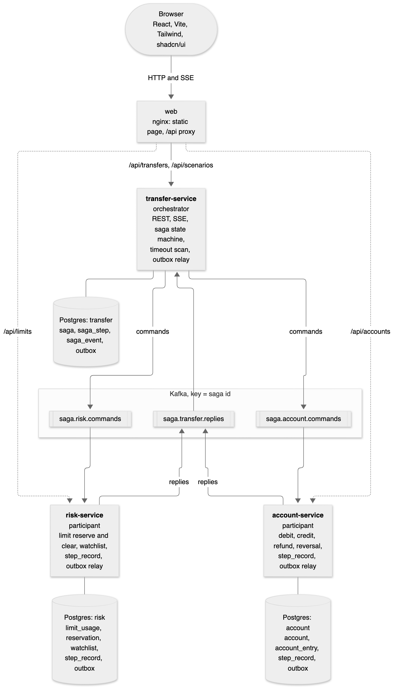
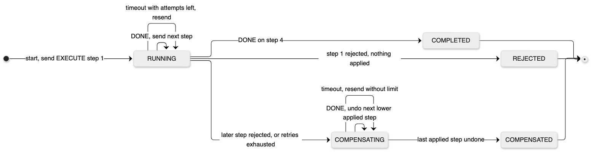
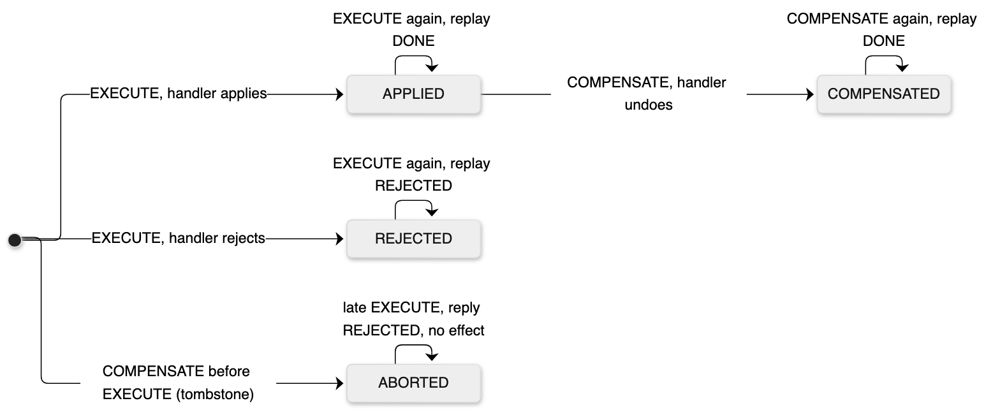

# SDD: java-saga-pattern (v1)

> **Status:** Draft.
> **Author:** Jader Santos.
> **Companion diagrams:** [`diagrams/`](diagrams/), one `.mmd` per diagram, exported to PNG with `make diagrams`.
> **Open questions:** see [§13](#13-open-questions).

---

## 1. Context

A bank transfer that touches more than one service has no single database transaction to lean on. The limit lives in one service, the balances in another, and each one commits on its own. When a later step fails, the earlier steps already committed and must be undone by a new, forward transaction. That is the saga pattern: a sequence of local transactions, each with a compensating transaction.

Most saga samples stop at the happy path or at one rejection. The parts that break in production are elsewhere: a reply that never arrives, a command delivered twice, a compensation that fails, a step whose outcome is unknown, an orchestrator that restarts in the middle of a saga.

## 2. Problem

There is no small, runnable project that runs a money transfer as a saga across services, injects those failures on demand, and shows in real time what the saga does about each one.

## 3. Goals

* Dummy transfers between accounts of different owners, run as an orchestrated saga across three Spring Boot services.
* Every step has a compensation. A failure at any step reverts the steps before it, across both participant services.
* Saga state survives an orchestrator restart. A saga in flight resumes from the database.
* Each participant is idempotent on a business key and refuses a command that arrives after its compensation.
* A scenario catalog that triggers every path on demand: business rejections, lost replies, crashes before commit, failing compensations, unknown outcomes.
* A minimal web page that runs each scenario and shows the saga live, with a progress bar per step and a timeline.
* One command to start everything, one command to run every scenario end to end and check that no money was created or lost.

## 4. Non-goals

* Authentication, users, real money, FX, fees, interest.
* Throughput or latency records.
* Multi-instance deployment. Saga state, row locks, the `SKIP LOCKED` timeout scan and the per-host Kafka instance id allow more than one instance. The outbox relay is safe with several pods (§6.6). One thing is not: the SSE fan-out is in memory ([§13 Q2](#13-open-questions)).
* A generic saga framework. The engine runs one saga definition, the transfer.

---

## 5. Key decisions

### 5.1 Orchestration, not choreography

| | Orchestration | Choreography |
|---|---|---|
| Where the flow lives | One class in the orchestrator | Spread over every participant's listeners |
| Who knows the saga state | The orchestrator, in one table | Nobody. Rebuilt from events |
| Adding a step | Change the definition | Change every service that reacts to the previous event |
| Compensation order | Explicit, reverse of the definition | Each service must listen for every failure event after it |
| Cyclic dependencies between services | None. Participants only know their own commands | Common |
| Single point of failure | The orchestrator, mitigated by durable state | None |

With four steps and compensation in reverse order, choreography spreads one decision across three code bases. The progress bar also needs one place that knows the whole state. Orchestration wins here.

### 5.2 REST commands or event-driven commands

The orchestrator has to send four commands and four possible compensations to two participants. Two ways to carry them:

| Criterion | REST (orchestrator calls participants) | Event-driven (Kafka commands and replies) |
|---|---|---|
| Participant down | The call fails. The orchestrator needs its own retry scheduler, so it builds a queue anyway | The command waits in the topic and runs when the participant is back |
| Temporal coupling | Both sides must be up at the same time | None |
| Timeout with unknown outcome | Yes. Needs an idempotent retry | Yes. Needs an idempotent consumer. Same problem, same fix |
| Atomic state change plus send | Persist state, call, persist result. A crash in between is recovered by retrying the call | Needs a transactional outbox in every service, plus a relay |
| Moving parts | Three services, Postgres | Three services, Postgres, Kafka, one outbox relay per service |
| Latency per step | One HTTP round trip | Relay poll interval plus two Kafka hops |
| Back pressure | Caller threads and bulkheads | Consumer lag absorbs bursts |
| Long-running steps (manual review, another bank) | Poor: hold the request or poll | Natural: the reply comes when it comes |
| Ordering | Sequential by construction | Per saga, because the saga id is the partition key |
| Debugging | Synchronous stack traces | Saga id in every log line and message key. Harder to follow |
| Testing | WireMock | Testcontainers Kafka, asynchronous asserts |

Decision: **event-driven commands and replies** for the saga steps. REST stays at the edge: the browser starts a transfer and reads accounts over HTTP, and follows progress over Server-Sent Events.

Why: the failures this project exists to show (participant down, lost reply, redelivery) are the normal case for messaging and an afterthought for REST. With REST the orchestrator ends up with a retry table and a scheduler, which is a queue built by hand. The cost is Kafka and an outbox in every service, and it is accepted.

When REST is the better choice: two services owned by one team, all steps fast, low volume, no step that waits on a person or another bank. A persisted orchestrator with idempotency keys on every call is enough there, and simpler.

### 5.3 Where the saga state lives

| Option | Atomic with the outbox | Durable | Queryable for UI and ops | Extra infrastructure | Notes |
|---|---|---|---|---|---|
| **PostgreSQL** | Yes, same transaction | Yes | SQL | None, the services already need it | Row lock per saga, `FOR UPDATE SKIP LOCKED` for the timeout scan |
| Redis | No | Only with AOF `always` | Poor | Redis | A crash between the state write and the send needs a second mechanism |
| MongoDB | Only with multi-document transactions on a replica set | Yes | Good | MongoDB replica set | Brings a second database type for no gain |
| Kafka compacted topic or Streams state store | Yes with Kafka transactions | Yes | Interactive queries only | None beyond Kafka | Hard to query a stuck saga, harder to fix one by hand |
| Temporal | Built in | Yes | Temporal UI | Temporal cluster and its database | Strong choice for production. Hides the pattern, which is the thing this project shows |
| Camunda 8 (Zeebe) | Built in | Yes | Operate | Zeebe, Elasticsearch | BPMN modeling, heavy for four steps |
| Axon Framework | Built in | Yes | Axon Server | Axon Server | Pushes event sourcing on every service |

Decision: **PostgreSQL 18**, one database per service on one instance. The saga row, its step rows, its timeline and its outgoing command commit in one local transaction. A stuck saga is one `SELECT` away.

For a production system with many saga types and long waits (days, people in the loop), Temporal is the first alternative to evaluate ([§11.1](#111-temporal-instead-of-an-own-engine)).

### 5.4 Step order

| # | Step | Participant | Does | Rejects when | Compensation |
|---|---|---|---|---|---|
| 1 | `RESERVE_LIMIT` | `risk-service` | Reserves the amount against the source account's daily limit | Reserved plus used plus amount is over the limit | Releases the reservation |
| 2 | `DEBIT_SOURCE` | `account-service` | Debits the source account | Insufficient funds, account frozen, currency mismatch | Refunds the source |
| 3 | `CREDIT_DESTINATION` | `account-service` | Credits the destination account | Account frozen, currency mismatch | Reverses the credit |
| 4 | `CLEAR_TRANSFER` | `risk-service` | Screens the destination against the watchlist, moves the reservation to used | Destination on the watchlist | Moves the amount back from used to reserved |

Transfers with `requiresApproval: true` get a fifth step, `APPROVE_TRANSFER`, between debit and credit. It is a manual step owned by the orchestrator: no participant and no command. The saga stays `RUNNING` with the step `IN_PROGRESS` until someone calls approve or decline, or until `saga.approval-timeout` passes, which counts as a decline. The money is debited and held while it waits, so a decline refunds the debit and releases the limit. The approval has nothing to undo, so a later failure skips it during compensation. There is no authentication: anyone who can reach the API can approve ([§4](#4-non-goals)).

The screening runs last on purpose: one scenario then rolls back every earlier step in both participants. In production the screening runs before any money moves ([§13 Q1](#13-open-questions)).

Debit and credit are two steps in the same database on purpose. It gives one participant with two compensations (refund and reversal) and a failure point between two money moves, which is what the demo has to show. A real ledger posts both legs in one local transaction (double entry), and a saga coordinates across ledgers or banks, not across the legs of one posting.

Every step has a compensation, including the last one. The orchestrator compensates a step whose outcome is unknown (retries exhausted), so the last step must be undoable too. A reversed credit can leave the destination balance negative: it is a bank correction, not a customer debit, and it is allowed.

---

## 6. Proposed design

### 6.1 High level



| Diagram | Shows |
|---|---|
| [`01-architecture`](diagrams/01-architecture.png) | Containers, topics and databases |
| [`02-happy-path`](diagrams/02-happy-path.png) | One full saga with outbox, relay and SSE |
| [`03-saga-states`](diagrams/03-saga-states.png) | Saga status machine |
| [`04-participant-step`](diagrams/04-participant-step.png) | Participant `step_record` states, including the tombstone |
| [`05-compensation`](diagrams/05-compensation.png) | Watchlisted beneficiary, three compensations |
| [`06-lost-reply`](diagrams/06-lost-reply.png) | Timeout, resend and replay from the step record |
| [`07-data-model`](diagrams/07-data-model.png) | Tables of the three databases |

```
 browser  --HTTP + SSE-->  web (nginx)  --/api/transfers, /api/scenarios-->  transfer-service (orchestrator)
                                        --/api/accounts-->                   account-service
                                        --/api/limits-->                     risk-service

 transfer-service --outbox--> saga.risk.commands    --> risk-service    --outbox--+
                  --outbox--> saga.account.commands --> account-service --outbox--+--> saga.transfer.replies --> transfer-service

 postgres: databases transfer, account, risk. One user per database.
```

### 6.2 Components

| Component | Responsibility | Where it lives |
|---|---|---|
| `transfer-service` | Transfer API, scenario catalog, saga state machine, timeout scan, SSE progress | `transfer-service` |
| `account-service` | Accounts and balances, debit and credit steps, account list for the UI | `account-service` |
| `risk-service` | Daily limits and watchlist, reserve and clear steps, limit usage for the UI | `risk-service` |
| `messaging` | Message contracts, outbox writer and relay, participant runtime (idempotency, tombstones, fault injection), topic setup | `messaging` (jar, no `main`) |
| `web` | React page: scenarios, live progress, timeline, balances before and after | `web` |

`messaging` is the one shared module. Without it the outbox, the relay and the participant runtime exist three times, and the command and reply records twice. It holds no business rule. A participant only implements the business side of its steps.

### 6.3 Repository layout

```
java-saga-pattern/
  pom.xml                      parent, packaging pom, Spring Boot 4.1.2 parent
  messaging/                   shared jar
  transfer-service/            orchestrator
  account-service/             participant
  risk-service/                participant
  web/                         React, Vite, Tailwind, shadcn/ui; nginx image for compose
  infra/postgres/init.sql      databases and users
  scripts/e2e.sh               runs every scenario, checks outcomes and money conservation
  compose.yaml, Makefile
  docs/SDD.md, docs/diagrams/
```

Packages per service, layered, with a pure domain in the orchestrator:

| Package | Role | Depends on |
|---|---|---|
| `transfer.domain` | `TransferSaga`, statuses, `Transition`. The step order is the declaration order of `Step`. No Spring, no JDBC, no Jackson | `messaging.contract` |
| `transfer.app` | Runs each transition in one transaction: lock, decide, save, append events, write commands | `domain`, `persistence`, `messaging` |
| `transfer.persistence` | `JdbcClient` stores for sagas, steps and events | `domain` |
| `transfer.api` | Controllers, SSE hub, request records, scenario catalog | `app`, `domain`, `persistence` for read views |
| `account`, `risk` | One `StepHandler` per service, one store, one controller. Flat package, small enough | `messaging` |

ArchUnit tests keep `transfer.domain` free of Spring, Jackson and JDBC, and keep `persistence` and `app` from reaching up.

### 6.4 Saga state machine



Saga statuses:

| Status | Terminal | Meaning |
|---|---|---|
| `RUNNING` | No | Executing forward steps |
| `COMPENSATING` | No | Undoing applied steps, last first |
| `COMPLETED` | Yes | Every step applied |
| `COMPENSATED` | Yes | A step failed, every applied step was undone |
| `REJECTED` | Yes | The first step failed. Nothing to undo |

Step statuses: `PENDING`, `IN_PROGRESS`, `SUCCEEDED`, `REJECTED`, `TIMED_OUT`, `COMPENSATING`, `COMPENSATED`.

Transitions, all in `TransferSaga`, pure functions from state plus input to a new state, a list of commands and a list of timeline events:

| Input | Condition | Result |
|---|---|---|
| start | - | Step 1 `IN_PROGRESS`, send `EXECUTE` step 1, attempt 1 |
| reply `EXECUTE` `DONE` | Matches the current step | Step `SUCCEEDED`. Next step, or `COMPLETED` after step 4 |
| reply `EXECUTE` `REJECTED` | Matches the current step | Step `REJECTED`, start compensation below it |
| timeout | Forward, attempts left | Resend the same command, attempt + 1 |
| timeout | Forward, no attempts left | Step `TIMED_OUT`, start compensation from it, included |
| reply `COMPENSATE` `DONE` | Matches the current step | Step `COMPENSATED`, compensate the next lower applied step, or `COMPENSATED` |
| timeout | Compensating | Resend, no attempt limit |
| any reply | Does not match the current step and action, or saga terminal | Ignored, logged as a duplicate in the timeline |

Start compensation from step `k`: find the highest step at or below `k` with status `SUCCEEDED` or `TIMED_OUT`. None found means `REJECTED`. Compensations retry without limit, since a saga that cannot compensate leaves money in the wrong place. The attempt count is on the timeline and in a metric.

Retry policy. The wait before a resend doubles per attempt, `step-timeout * 2^(attempt - 1)`, capped at `max-backoff`:

| Attempt | 1 | 2 | 3 | 4 and later |
|---|---|---|---|---|
| Wait with the defaults | 3 s | 6 s | 12 s | 24 s |

A forward step gets 21 s in total before it is `TIMED_OUT`. Compensations follow the same schedule and stay at the cap. The deadline starts when the transition commits, not when the relay publishes, so relay lag eats into it.

Timeout scan. Every 250 ms it lists up to `timeout-batch` overdue saga ids, then handles each saga in its own transaction: lock the row with `SKIP LOCKED`, check that it is still overdue, apply the timeout. A saga that a reply listener holds is skipped and comes back next round. If the timeout handling throws, the error is logged with the `sagaId` in the MDC, `saga.parked` is incremented and the deadline moves `park-on-failure` ahead, so one broken saga never blocks the others.

The `saga` row also keeps `current_step`, `current_action` and `attempt`. The state machine rebuilds from `saga_step`; these columns are there so a stuck saga is readable with one `SELECT`.

### 6.5 Participant runtime



Each participant keeps one row per saga and step in `step_record`, keyed on the business key `(saga_id, step)`. The row is the idempotency record, the stored reply, and the tombstone.

| Command | Row before | Does | Row after | Reply |
|---|---|---|---|---|
| `EXECUTE` | none | Runs the handler | `APPLIED` or `REJECTED` with reason | `DONE` or `REJECTED` |
| `EXECUTE` | any | Nothing | unchanged | Stored outcome, `duplicate = true` |
| `COMPENSATE` | `APPLIED` | Runs the compensation | `COMPENSATED` | `DONE` |
| `COMPENSATE` | `COMPENSATED`, `REJECTED`, `ABORTED` | Nothing | unchanged | `DONE`, `duplicate = true` |
| `COMPENSATE` | none | Nothing to undo | `ABORTED` (tombstone) | `DONE` |
| `EXECUTE` after a tombstone | `ABORTED` | Nothing | unchanged | `REJECTED`, reason `aborted by an earlier compensation` |

The tombstone closes the classic saga anomaly: the orchestrator times out, compensates a step that never ran, and then the original command arrives late. Without the tombstone the late debit would apply and never be refunded.

Handler, row and reply commit in one transaction. A handler that needs data at compensation time keeps it in its own table: the risk service writes a `reservation` row with the limit day and amount.

### 6.6 Messaging

| Topic | Key | Producer | Consumer | Partitions |
|---|---|---|---|---|
| `saga.risk.commands` | saga id | `transfer-service` | `risk-service` | 3 |
| `saga.account.commands` | saga id | `transfer-service` | `account-service` | 3 |
| `saga.transfer.replies` | saga id | both participants | `transfer-service` | 3 |
| `<topic>.DLT` | same | error handler | nobody, kept for inspection | 1 |

Every service declares the topics with `NewTopic` beans, so a fresh broker needs no setup step.

Messages are JSON strings. Records in `messaging.contract`:

```java
public record SagaCommand(UUID sagaId, Step step, Action action, int attempt, TransferTerms terms, List<Fault> faults) {}
public record SagaReply(UUID sagaId, Step step, Action action, int attempt, Outcome outcome, String reason, boolean duplicate) {}
public record TransferTerms(String sourceAccountId, String destinationAccountId, Money amount) {}
public record Money(BigDecimal amount, Currency currency) {}
```

Outbox and relay:

* `OutboxWriter.append(topic, key, message)` inserts into `outbox` inside the caller's transaction.
* `OutboxRelay` runs every 100 ms: takes the relay lock, claims up to 100 rows in id order, sends them, waits for every ack, deletes them, commits. A failed send rolls the batch back and the rows go again next round. At least once, by design; the consumers are idempotent.
* One relay sends at a time per service. Each tick starts with `pg_try_advisory_xact_lock(hashtext('outbox-relay'))`; a pod that does not get it returns at once. The lock belongs to the transaction, so commit, rollback or a dropped connection releases it, and the next tick on any pod takes over. Advisory locks are per database, so this needs one database per service.
* Per-saga order holds end to end because of five things together: one sender at a time; each saga's transactions commit in id order (the `saga` row lock in the orchestrator, one consumer thread per partition in the participants); the relay sends in id order; the producer is idempotent with `acks=all` and at most 5 requests in flight, pinned in `MessagingAutoConfiguration`; and the saga id is the key. `OutboxRelayIT` runs three relays at once over 2,000 rows and 50 keys and checks the order per key. Without the lock it fails.
* A leader that dies without closing its connection would hold the lock until Postgres notices. Each service role has `idle_in_transaction_session_timeout = 30s` (`db-init` V2), above the 10 s ack timeout, and Postgres runs with TCP keepalives at 30 s. A dead leader is gone in about 30 s.
* One sender caps throughput per service at about 100 rows per Kafka ack round trip, a few thousand messages per second. The first lever is the batch size, the second is Debezium (§11.3). `outbox.oldest.age` shows saturation first.
* Listeners commit the offset after the database transaction. A crash in between redelivers, and the participant answers with the stored outcome.
* A message that cannot be parsed, or that fails with `IllegalArgumentException` or `NullPointerException`, goes to the DLT with no retries, since a retry cannot fix it. Other errors retry with exponential back off from 200 ms for up to 5 s, then go to the DLT. Every DLT send increments `kafka.dead.letter{topic}`.
* Listener work per record must stay well under `max.poll.interval.ms` (5 min). With 700 ms of demo latency and 500 records per poll, a burst of duplicates after an outage could reach it; production sets `max.poll.records` to match the slowest handler.
* Consumers use static membership and a 10 s session timeout. `group.instance.id` is the service name plus the host name (the container id in compose), so a restarted container gets its old id back and two replicas never share one. `KAFKA_INSTANCE_ID` overrides it. Without it, a killed orchestrator gets its reply partitions back only after the broker expires the dead member (45 s by default); meanwhile the timeout scan exhausts retries and compensates a saga that would have completed. Found with the restart check in §6.9.

### 6.7 Data model

`transfer` database:

```sql
CREATE TABLE saga (
    id                      UUID PRIMARY KEY,
    idempotency_key         TEXT NOT NULL UNIQUE,
    source_account_id       TEXT NOT NULL,
    destination_account_id  TEXT NOT NULL,
    amount                  NUMERIC(19, 2) NOT NULL CHECK (amount > 0),
    currency                CHAR(3) NOT NULL,
    faults                  JSONB NOT NULL DEFAULT '[]',
    status                  TEXT NOT NULL,
    current_step            TEXT NOT NULL,
    current_action          TEXT NOT NULL,
    attempt                 INT NOT NULL,
    deadline                TIMESTAMPTZ,
    reason                  TEXT,
    created_at              TIMESTAMPTZ NOT NULL,
    updated_at              TIMESTAMPTZ NOT NULL
);
CREATE INDEX saga_due ON saga (deadline) WHERE status IN ('RUNNING', 'COMPENSATING');
CREATE INDEX saga_recent ON saga (created_at DESC);

CREATE TABLE saga_step (
    saga_id   UUID NOT NULL REFERENCES saga (id),
    position  INT NOT NULL,
    step      TEXT NOT NULL,
    status    TEXT NOT NULL,
    PRIMARY KEY (saga_id, position)
);

CREATE TABLE saga_event (
    id           BIGSERIAL PRIMARY KEY,
    saga_id      UUID NOT NULL REFERENCES saga (id),
    occurred_at  TIMESTAMPTZ NOT NULL,
    type         TEXT NOT NULL,
    step         TEXT,
    action       TEXT,
    attempt      INT NOT NULL,
    detail       TEXT
);
CREATE INDEX saga_event_by_saga ON saga_event (saga_id, id);
```

`account` database:

```sql
CREATE TABLE account (
    id          TEXT PRIMARY KEY,
    owner_name  TEXT NOT NULL,
    currency    CHAR(3) NOT NULL,
    balance     NUMERIC(19, 2) NOT NULL,
    status      TEXT NOT NULL
);
CREATE TABLE account_entry (
    id          BIGSERIAL PRIMARY KEY,
    account_id  TEXT NOT NULL REFERENCES account (id),
    saga_id     UUID NOT NULL,
    kind        TEXT NOT NULL,
    amount      NUMERIC(19, 2) NOT NULL,
    created_at  TIMESTAMPTZ NOT NULL
);
CREATE INDEX account_entry_by_account ON account_entry (account_id, id);
```

`risk` database:

```sql
CREATE TABLE limit_usage (
    account_id  TEXT NOT NULL,
    day         DATE NOT NULL,
    reserved    NUMERIC(19, 2) NOT NULL DEFAULT 0 CHECK (reserved >= 0),
    used        NUMERIC(19, 2) NOT NULL DEFAULT 0 CHECK (used >= 0),
    PRIMARY KEY (account_id, day)
);
CREATE TABLE reservation (
    saga_id     UUID PRIMARY KEY,
    account_id  TEXT NOT NULL,
    day         DATE NOT NULL,
    amount      NUMERIC(19, 2) NOT NULL CHECK (amount > 0)
);
CREATE TABLE watchlist (
    account_id  TEXT PRIMARY KEY,
    reason      TEXT NOT NULL
);
```

Shared, from the `messaging` jar. `outbox` is in `classpath:db/messaging` (every service), `step_record` in `classpath:db/participant` (participants only). Versions are `0.x` so they run before the service's own:

```sql
CREATE TABLE outbox (
    id          BIGSERIAL PRIMARY KEY,
    topic       TEXT NOT NULL,
    msg_key     TEXT NOT NULL,
    payload     TEXT NOT NULL,
    created_at  TIMESTAMPTZ NOT NULL DEFAULT now()
);

CREATE TABLE step_record (
    saga_id     UUID NOT NULL,
    step        TEXT NOT NULL,
    status      TEXT NOT NULL,
    reason      TEXT,
    updated_at  TIMESTAMPTZ NOT NULL,
    PRIMARY KEY (saga_id, step)
);
```

Money is `NUMERIC(19, 2)` in the database and `BigDecimal` with a `Currency` in Java. Debit is one statement that cannot overdraw:

```sql
UPDATE account SET balance = balance - :amount
WHERE id = :id AND status = 'ACTIVE' AND currency = :currency AND balance >= :amount
```

Zero rows updated means a rejection; a second query reads the account to pick the reason.

### 6.8 HTTP API

`transfer-service`:

| Endpoint | Purpose | Notes |
|---|---|---|
| `GET /api/scenarios` | Scenario catalog | The page and `e2e.sh` read the same list |
| `POST /api/transfers` | Start a transfer | `Idempotency-Key` header required. `202` with the view. Same key and same body returns the first transfer with `200`; same key, other body is `422`. Two requests with the same new key at the same time: one wins, the other gets `409` and retries |
| `GET /api/transfers?limit=10` | Recent transfers | |
| `GET /api/transfers/{id}` | Saga view: status, steps, timeline | |
| `POST /api/transfers/{id}/approve` | Approve a transfer waiting on `APPROVE_TRANSFER` | `200` with the view. `409` when it is not waiting, `404` when unknown |
| `POST /api/transfers/{id}/decline` | Decline it; the saga compensates | Same codes |
| `GET /api/transfers/{id}/stream` | SSE, event `saga` with the full view after every committed transition | First event is the current view. Closes after a terminal status |

```json
POST /api/transfers
Idempotency-Key: 9b4c2d0e-0f7e-4c61-9d3f-0a1c2b3d4e5f

{
  "sourceAccountId": "ACC-1001",
  "destinationAccountId": "ACC-5005",
  "amount": 75.00,
  "currency": "USD",
  "faults": [{ "step": "DEBIT_SOURCE", "action": "COMPENSATE", "kind": "CRASH_BEFORE_COMMIT", "times": 2 }]
}
```

`account-service`: `GET /api/accounts`, `POST /api/accounts/reset`.
`risk-service`: `GET /api/limits`, `POST /api/limits/reset`.

The reset endpoints restore the seed data so the scenarios give the same result every time. They do not know about sagas: a reset while a saga runs leaves its compensation working on fresh balances. Run them only when nothing is in flight. They exist for the demo and have no place in a real system. Errors are Problem Details (RFC 9457).

SSE: the browser opens one `EventSource` per transfer. The hub sends the view after commit (`@TransactionalEventListener(AFTER_COMMIT)`), so the page never shows a state that rolled back. The send runs `@Async` on a virtual thread, so a slow browser never holds the Kafka reply listener. Views can then arrive out of order; the page keeps the one with the highest event id.

### 6.9 Scenarios and fault injection

Faults travel in the command. The participant runtime applies them, never the business handler. Two kinds:

| Fault | Effect | What it simulates |
|---|---|---|
| `LOSE_REPLY` | The step commits, the reply is not written | A reply lost after the commit |
| `CRASH_BEFORE_COMMIT` | The handler runs, then the transaction rolls back, no reply | A crash in the middle of the step |

A fault applies while `attempt <= times`, so retries behave deterministically.

Seed data:

| Account | Owner | Balance (USD) | Status | Risk |
|---|---|---|---|---|
| `ACC-1001` | Alice Martins | 10,000.00 | `ACTIVE` | daily limit 5,000.00 |
| `ACC-2002` | Bob Silva | 2,500.00 | `ACTIVE` | |
| `ACC-3003` | Carol Souza | 80.00 | `ACTIVE` | |
| `ACC-4004` | Dave Costa | 1,000.00 | `FROZEN` | |
| `ACC-5005` | Mallory Reis | 500.00 | `ACTIVE` | on the watchlist |

Every account has the default daily limit of 5,000.00.

Catalog:

| Id | Transfer | Fault | Expected | What it proves |
|---|---|---|---|---|
| `happy-path` | Alice to Bob, 120.00 | - | `COMPLETED` | Four steps, two services |
| `limit-exceeded` | Alice to Bob, 6,000.00 | - | `REJECTED` | First step fails, nothing to undo |
| `insufficient-funds` | Carol to Bob, 250.00 | - | `COMPENSATED` | Release the limit in `risk-service` |
| `frozen-destination` | Alice to Dave, 90.00 | - | `COMPENSATED` | Refund in `account-service`, release in `risk-service` |
| `watchlisted-beneficiary` | Alice to Mallory, 75.00 | - | `COMPENSATED` | Three compensations across both participants |
| `lost-reply` | Alice to Bob, 40.00 | `LOSE_REPLY` on debit, once | `COMPLETED` | Timeout, resend, participant answers from its record, money moves once |
| `crash-then-recover` | Alice to Bob, 55.00 | `CRASH_BEFORE_COMMIT` on credit, twice | `COMPLETED` | Two rollbacks, third attempt applies |
| `compensation-retried` | Alice to Dave, 65.00 | `CRASH_BEFORE_COMMIT` on refund, twice | `COMPENSATED` | A compensation retries until it succeeds |
| `unknown-outcome` | Alice to Bob, 30.00 | `LOSE_REPLY` on credit, three times | `COMPENSATED` | Retries exhausted, the credit that did apply is reversed |
| `manual-approval` | Alice to Bob, 150.00, `requiresApproval` | - | `COMPLETED` when approved, `COMPENSATED` when declined or expired | A human step inside the saga. `e2e.sh` runs it both ways |

Orchestrator restart is a manual check in the README: start `crash-then-recover`, kill `transfer-service` with `SIGKILL` while a step is waiting, start it again, watch the saga finish.

### 6.10 Timing

| Setting | Default | Why |
|---|---|---|
| `saga.step-timeout` | 3 s | Longer than the demo step latency, short enough to watch a retry |
| `saga.max-backoff` | 24 s | Cap for the doubling wait. See the retry policy in §6.4 |
| `saga.max-attempts` | 3 | Forward steps only. Compensations have no limit. The fault scenarios are built from it |
| `saga.timeout-batch` | 20 | Overdue sagas per scan round, one transaction each |
| `saga.park-on-failure` | 1 min | How far the deadline moves when timeout handling throws |
| `saga.approval-timeout` | 2 min | How long a transfer waits for approval before it is declined |
| `saga.timeout-scan-interval` | 250 ms | |
| `participant.step-latency` | 700 ms in compose, 0 in tests | Makes each step visible on the progress bar |
| `outbox.relay-interval` | 100 ms | |

### 6.11 Web page

| Concern | Choice | Notes |
|---|---|---|
| Stack | React 19, TypeScript, Vite 8, Tailwind CSS 4, shadcn/ui | The agreed stack. shadcn components live in the repo as source, which is what makes them easy for an AI assistant to read and change |
| Structure | One page, no router | Scenario list on the left, run panel on the right |
| Progress | Four segments, one per step, colored by step status. Forward fills left to right, compensation turns segments amber, then gray when undone. A thin bar under it shows overall progress: "Executing 2 of 4", "Rolling back 1 of 3" | Derived from the view by one pure function, unit tested |
| Timeline | Every saga event with time, step, attempt and detail. `aria-live="polite"` | Shows retries, duplicates and timeouts that the bar cannot |
| Proof | Balances of the two accounts before and after, and the net change. A compensated transfer shows a net change of 0.00 | The point of the page |
| Live updates | `EventSource` on `/api/transfers/{id}/stream` | No polling |
| Fetching | `fetch` and a small typed client | Four endpoints do not justify TanStack Query |
| Lint and test | oxlint, Vitest, Testing Library | |
| Theme | Light, and a dark theme close to IntelliJ Darcula. Toggle in the header, choice kept in `localStorage`, system preference on first visit | All colors are tokens in `index.css` |
| Dev | Vite proxies `/api` to the three services | No CORS anywhere |

### 6.12 Failure modes

| Failure | Detection | Response | Compensation |
|---|---|---|---|
| Business rejection at step `k` | Reply `REJECTED` | Stop forward | Steps `k-1` to 1 |
| Reply lost | Step deadline passes | Resend, same step and higher attempt. Participant answers from `step_record` | - |
| Participant crash before commit | Deadline passes | Resend. Nothing was applied | - |
| Participant down | Deadline passes, commands wait in the topic | Resends back off (3, 6, 12 s) and pile up as duplicates, answered from `step_record` | After `max-attempts`, steps `k` to 1 |
| Timeout handling throws for one saga | Exception in the scan | Logged, `saga.parked`, deadline moved 1 min ahead. Other sagas go on | - |
| Forward retries exhausted | Attempt count | Step `TIMED_OUT` | Steps `k` to 1, `k` included, since it may have applied |
| Compensation fails | Deadline passes | Resend forever | - |
| Command arrives after its compensation | `step_record` is `ABORTED` | Reply `REJECTED`, no effect | - |
| Duplicate or stale reply | Does not match the current step and action | Ignored, timeline event | - |
| Orchestrator crash | - | State, timeline and pending commands are in Postgres. Static Kafka membership hands the reply partitions back at once; the timeout scan resends what is overdue | - |
| Kafka down | Relay send fails | Outbox rows stay, relay retries | - |
| Poison message | JSON parse failure | DLT, no retries | Saga times out and compensates |

### 6.13 Observability

* Saga id as the Kafka key, and in the MDC (`sagaId`) for every log line of the listeners and the timeout scan.
* Actuator `health` and `prometheus` on every service.

| Metric | Service | Alert on |
|---|---|---|
| `saga.finished{status}` | transfer | Rate of `COMPENSATED` against `COMPLETED` |
| `saga.retries{step,action}` | transfer | Sudden rise: a participant is slow or down |
| `saga.active{status}` | transfer | `COMPENSATING` that keeps growing |
| `saga.compensating.oldest.age` | transfer | Over a few minutes: a compensation does not succeed |
| `saga.parked` | transfer | Any increase |
| `saga.decisions{approved}` | transfer | - |
| `outbox.depth`, `outbox.oldest.age` | all | Age over a few seconds: Kafka or the relay is stuck |
| `kafka.dead.letter{topic}` | all | Any increase |
* The timeline table is the audit trail of each saga.

---

## 7. Libraries and versions

Checked on Maven Central, npm and Docker Hub on 2026-11-09. **BOM** means from `spring-boot-dependencies` 4.1.2, never overridden in the poms. Spring Boot 4.2.0 is at RC2 on that date; the latest GA, 4.1.2, is used.

### 7.1 Runtime

| Item | Version | Notes |
|---|---|---|
| Java (Temurin) | 25 | LTS |
| Spring Boot | 4.1.2 | Parent of every module |
| Spring Framework, Spring Kafka, Jackson 3, Flyway, PostgreSQL JDBC, HikariCP, Micrometer | BOM | |
| PostgreSQL image | `postgres:18.6` | One instance, three databases |
| Kafka image | `apache/kafka:4.4.0` | KRaft, single broker |
| Node | 26 | `web` build |
| nginx | `nginx:1.31-alpine` | Serves `web`, proxies `/api` |

### 7.2 Build and test

| Item | Version | Notes |
|---|---|---|
| JUnit, AssertJ, Awaitility, Testcontainers | BOM | |
| ArchUnit | 1.5.1 | Domain package rule |
| jqwik | 1.10.2 | Property test of the state machine |
| Spotless Maven plugin | 3.11.0 | Palantir Java Format 2.103.0 |
| JaCoCo | 0.8.16 | |

### 7.3 Web

| Item | Version |
|---|---|
| React | 19.3 |
| TypeScript | 7.0 |
| Vite | 8.3 |
| Tailwind CSS | 4.3 |
| shadcn CLI | 4.23 |
| lucide-react | 1.70 |
| oxlint | 1.93 |
| Vitest | 5.1 |
| Testing Library React | 16.3 |

---

## 8. Configuration

Environment variables, with defaults for the compose network.

| Variable | Service | Default |
|---|---|---|
| `DB_HOST`, `DB_PORT` | all | `localhost`, `5432` |
| `DB_PASSWORD` | all | per service, local only |
| `KAFKA_BOOTSTRAP` | all | `localhost:9094` |
| `SAGA_STEP_TIMEOUT` | transfer | `3s` |
| `SAGA_MAX_BACKOFF` | transfer | `24s` |
| `SAGA_MAX_ATTEMPTS` | transfer | `3` |
| `SAGA_APPROVAL_TIMEOUT` | transfer | `2m` |
| `KAFKA_INSTANCE_ID` | all | service name plus host name |
| `STEP_LATENCY` | account, risk | `0ms`, `700ms` in compose |
| `RISK_DAILY_LIMIT` | risk | `5000.00` |

Ports: `web` 8080, `transfer-service` 8081, `account-service` 8082, `risk-service` 8083, Postgres 5432, Kafka 9094, Vite dev 5173. Compose binds all of them to `127.0.0.1`. nginx in `web` resolves the service names through Docker DNS every 5 s, so a recreated or scaled service is picked up without restarting `web`.

---

## 9. Testing

| Level | What | How |
|---|---|---|
| Unit | Every transition of `TransferSaga` | Plain JUnit, one test per scenario path |
| Property | For any failing step and any applied set, compensations run in strict reverse order and only for applied or unknown steps | jqwik |
| Architecture | `transfer.domain` imports no framework | ArchUnit |
| Participant runtime | Duplicate execute, compensate before execute, late execute after tombstone, both faults | Postgres Testcontainer, fake handler |
| Relay | Row in, message on the topic, row gone | Postgres and Kafka Testcontainers |
| Orchestrator | Full saga with scripted participants on real Kafka | Postgres and Kafka Testcontainers |
| Participants | Debit, credit, refund, reverse, reservation and clearing rules | Postgres Testcontainer |
| End to end | Every catalog scenario reaches its expected status. Sum of all balances is the same before and after | `scripts/e2e.sh` against compose |
| Web | Progress derivation, scenario run rendering | Vitest, Testing Library |

---

## 10. Build and run

```bash
make up        # postgres, kafka, three services, web on http://localhost:8080
make e2e       # every scenario, expected status, money conservation
make test      # Maven verify (Docker needed for Testcontainers) and web tests
make down
```

---

## 11. Alternatives considered

### 11.1 Temporal instead of an own engine

**What:** write the transfer as a Temporal workflow, compensations as a `Saga` object in the workflow.
**Why not:** it removes the state table, the timeout scan and the outbox, which are the parts this project wants to show. For production with many saga types and long waits it is the first thing to evaluate.

### 11.2 Spring State Machine

**What:** model the saga states with Spring State Machine and persist it with its JPA support.
**Why not:** five statuses and eight transitions fit in one class of pure functions that test without Spring. The library adds a configuration model and a persistence layer for no gain at this size.

### 11.3 Debezium CDC instead of a polling relay

**What:** stream the outbox table to Kafka with Debezium.
**Why not:** a Kafka Connect cluster for three small outboxes. The polling relay is a few dozen lines and has no extra process.

### 11.4 Choreography

See [§5.1](#51-orchestration-not-choreography).

### 11.5 Kafka transactions for exactly once

**What:** consume, produce and commit offsets in one Kafka transaction.
**Why not:** the database write is outside the Kafka transaction, so it does not give exactly once end to end. The idempotent participant does.

---

## 12. Risks and mitigations

| Risk | Likelihood | Impact | Mitigation |
|---|---|---|---|
| Two relays in one service reorder messages of one saga | Removed | - | One relay at a time per service, advisory lock (§6.6). Consumers stay order tolerant anyway: tombstone and stale reply checks |
| The relay leader dies without closing its connection | Low | High: no commands for the service until the lock is free | `idle_in_transaction_session_timeout` 30 s and TCP keepalives. Alert on `outbox.oldest.age` |
| A reversed credit takes a balance negative | Med in the demo | Low | Allowed as a bank correction, visible in the balances panel |
| Compensation never succeeds | Low | High | Unlimited retries with back off, `saga.compensating.oldest.age` to alert on, saga visible as `COMPENSATING` |
| Tables grow without limit (`saga_event`, `step_record`, `account_entry`) | Certain | Low in the demo | No retention job. Production partitions `saga_event` by month and deletes `step_record` rows older than the Kafka retention plus the longest saga |
| Reset during a running saga | Low, demo only | Low | Documented in §6.8 |
| SSE connection drops | Med | Low | The page reconnects; the first event is always the full view |
| Fault injection fields reach a real system | - | High | Demo project only. A real system would not accept faults from the client |

---

## 13. Open questions

| # | Question | Why it matters | Default assumed in this doc |
|---|---|---|---|
| Q1 | Screening first, as in production, with a different last step? | The last step is the only one that can roll back debit and credit together | Screening last, for the demo |
| Q2 | Should the SSE fan-out work across orchestrator instances (Postgres `LISTEN/NOTIFY`)? | Needed only if the orchestrator scales out | One instance, in-memory hub |
| Q3 | Should compensations stop after a number of attempts and park the saga for a person? | Real operations need a manual queue | Unlimited retries |

---

## 14. References

* Hector Garcia-Molina and Kenneth Salem, Sagas, 1987.
* Chris Richardson, Microservices Patterns, chapter 4, and microservices.io saga and transactional outbox pages.
* Pat Helland, Life beyond Distributed Transactions.
